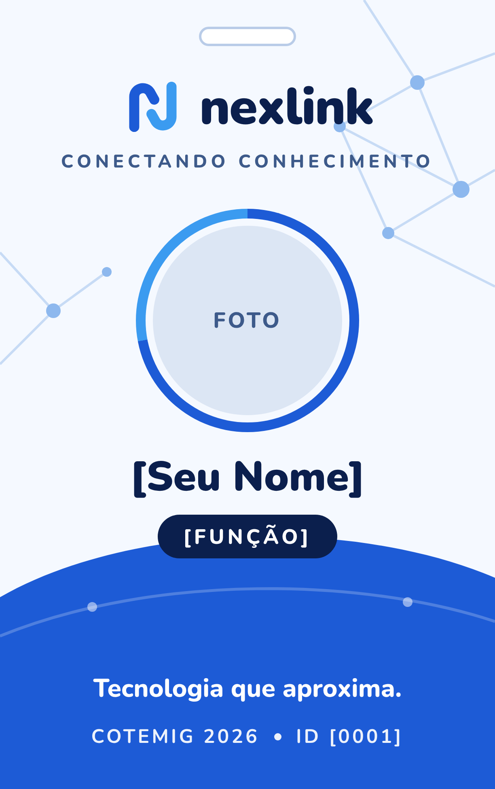
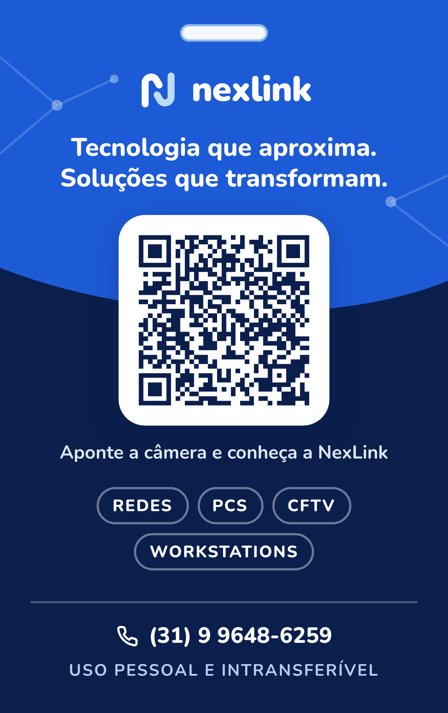

# Crachá NexLink

Crachá da equipe NexLink, com frente e verso no tamanho padrão de cartão (54 × 86 mm).

| Frente | Verso |
| --- | --- |
|  |  |

## Arquivos

- `index.html`: o crachá em HTML/CSS. Abra no navegador para ver ou use **Imprimir** (Ctrl+P) para gerar o PDF no tamanho certo.
- `cracha-nexlink.pdf`: versão pronta para impressão, com 2 páginas (frente e verso) em 54 × 86 mm.
- `cracha-frente.png` e `cracha-verso.png`: imagens em alta resolução.
- `qrcode-site.svg` e `qrcode-site.png`: QR code que leva ao site da NexLink.
- `fonts/`: fonte Nunito (licença SIL Open Font License, em `fonts/OFL.txt`).

## Como personalizar

No `index.html`, troque os textos entre colchetes, `[Seu Nome]`, `[Função]` e `[0001]`, e substitua o círculo "FOTO" por uma imagem `` da pessoa.

## QR code

O QR code aponta para https://nexlink-lab-tecnologia.cheekyjelly133.chatgpt.site/

Para gerar outro QR code em Python:

```bash
pip install segno
python -c "import segno; segno.make('URL_AQUI', error='q').save('qrcode.svg', scale=10, border=2, dark='#0B1F4D')"
```
